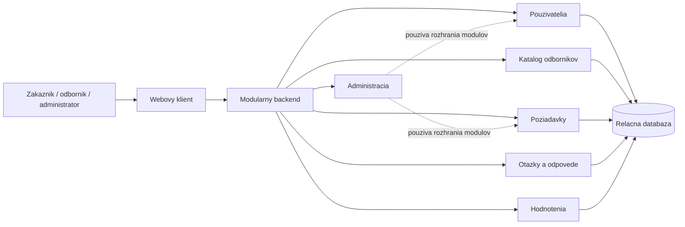

# ADR-001: Modularny monolit pre RentYourExpert

- **Stav:** prijate
- **Datum rozhodnutia:** 29. 10. 2026

## Kontext

RentYourExpert umoznuje zakaznikom vyhladavat odbornikov a posielat im poziadavky na sluzby. Odbornici spravuju svoj profil, odpovedaju na otazky a prijimaju alebo odmietaju poziadavky. Zakaznici mozu pridavat hodnotenia. Administrator spravuje pouzivatelov a obsah systemu.

Poziadavky neurcuju velku zataz, viac samostatnych timov ani potrebu nezavisleho nasadzovania casti systemu. Riesenie ma byt jednoduche, bezpecne a udrziavatelne.

## Rozhodovacie kriteria

- jednoduchy vyvoj a nasadenie,
- spravne overovanie roli a vlastnictva udajov,
- spolahlive zmeny stavov poziadaviek,
- zrozumitelne rozdelenie zodpovednosti,
- moznost neskorsieho rozsirenia.

## Posudzovane moznosti

| Moznost | Vyhody | Nevyhody |
|---|---|---|
| Vrstveny monolit | najjednoduchsi zaciatok, jedna databaza | slabsie hranice medzi funkciami |
| Modularny monolit | jasne moduly, jednoduche transakcie a nasadenie | moduly sa nedaju nasadit samostatne |
| Mikrosluzby | samostatne nasadenie a skalovanie | zlozita komunikacia, prevadzka a konzistencia udajov |

## Rozhodnutie

System bude vytvoreny ako **modularny monolit**. Bude mat jeden backend, jedno nasadenie a jednu relacnu databazu.

Backend bude rozdeleny na tieto moduly:

- **Pouzivatelia a opravnenia** - registracia, prihlasenie, profily a roly;
- **Katalog odbornikov** - profily odbornikov a vyhladavanie;
- **Poziadavky na sluzby** - vytvorenie, zrusenie, prijatie a odmietnutie poziadavky;
- **Otazky a odpovede** - otazky zakaznikov a odpovede odbornikov;
- **Hodnotenia** - vytvorenie, uprava, zobrazenie a odstranenie hodnotenia;
- **Administracia** - sprava systemu cez rozhrania ostatnych modulov.

Kazdy modul spravuje vlastne pravidla a tabulky. Priamy zapis do tabuliek ineho modulu nebude povoleny.

## Praca s udajmi a bezpecnost

- Hesla sa ukladaju iba vo forme bezpecneho hashu.
- Kazda chranena operacia overi rolu aj vlastnictvo zaznamu.
- Zakaznik moze menit iba vlastny profil, poziadavky a hodnotenia.
- Odbornik moze spracovat iba poziadavky adresovane jemu.
- Zmenu stavu poziadavky vykonava iba modul Poziadavky na sluzby.
- Pri odstraneni pouzivatela sa historicke udaje anonymizuju, ak ich treba zachovat.
- Vyhladavanie odbornikov bude najprv pouzivat indexovane databazove dotazy.

## Dosledky

### Vyhody

- jednoduche spustenie, testovanie a nasadenie,
- transakcie v jednej databaze,
- jasne rozdelenie funkcii,
- nizsia prevadzkova narocnost nez pri mikrosluzbach,
- moznost neskor oddelit vybrany modul.

### Nevyhody

- cely backend sa nasadzuje naraz,
- moduly sa nedaju skalovat samostatne,
- chyba v spolocnom procese moze ovplyvnit celu aplikaciu,
- hranice modulov treba kontrolovat testami a kontrolou zavislosti.

## Rizika

- chybajuca kontrola opravnenia na niektorom koncovom bode,
- neplatny prechod medzi stavmi poziadavky,
- priame pouzivanie cudzich databazovych tabuliek,
- nejasne spracovanie suvisiacich udajov pri odstraneni uctu.

Rizika sa znizia automatickymi testami opravneni, testami zmien stavov, databazovymi obmedzeniami a kontrolou zavislosti medzi modulmi.

## Opatovne posudenie rozhodnutia

Rozhodnutie sa znovu posudi, ak bude niektory modul potrebovat samostatne skalovanie, na moduloch zacnu pracovat nezavisle timy alebo spolocne nasadzovanie zacne vyrazne spomalovat vyvoj. Dovtedy nie su naklady mikrosluzieb odovodnene.
